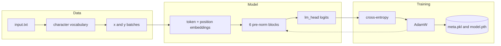

# TinySpeare

TinySpeare is a character-level Transformer I built from scratch in PyTorch as a
portfolio piece, working through Andrej Karpathy's nanoGPT series. The model has
80,193 parameters: a 32-dimensional embedding, four attention heads, six
pre-norm residual blocks, and an 8-character context window. `train.py` learns a
character vocabulary from any UTF-8 text file, trains with AdamW, and writes
`meta.pkl` and `model.pth`. `generate.py` loads that checkpoint and samples 500
new characters from an empty prompt. The published checkpoint was trained on the
Tiny Shakespeare file in `input.txt`, where the vocabulary is 65 characters.

```text
Show! this is not,
I much this thell for to in crowbeliself. And not a speak in Will dire good, they king, and that did Edwer more we genit of Rome;
Why's that blood lamen, thy Bewwive eartare,
I rive frience be affled sea
Good, city flewn:' I tyum rups onour's arrews; and
Will stquall better thee we will every was
Whus is my listroish--live: 'did sempelf that.

GLOUCESTER:
I truther,
To bettent. For lost.

MERCUTIO:
My all a greatuor to him as master
they somer's prause, I worved-man and Jull w
```

_A sample generated from the published `model.pth` with an empty prompt and
`max_new_tokens=500`. The sampler uses raw multinomial draws, so a rerun produces
different text._

## Table of contents

- [Source](#source)
- [What is implemented](#what-is-implemented)
- [Reading order](#reading-order)
- [Requirements](#requirements)
- [Run it](#run-it)
- [Expected output](#expected-output)
- [Configuration](#configuration)
- [How it works](#how-it-works)
- [Design notes](#design-notes)
- [Limits](#limits)
- [Stack](#stack)

## Source

I followed Andrej Karpathy's [nanoGPT repository](https://github.com/karpathy/nanoGPT)
and the [Let's build GPT: from scratch, in code, spelled out](https://www.youtube.com/watch?v=kCc8FmEb1nY)
lecture. The code condenses the lecture's decoder-only model into one module.
Hyperparameters live in `config.py`, training is a script, and the checkpoint
loader is separate. I did not pin a source commit.

## What is implemented

| Piece | Where | Status | Note |
| --- | --- | --- | --- |
| Character tokenizer | `train.py` | complete | Sorted unique characters, with `stoi` and `itos` pickled to `meta.pkl` |
| Causal self-attention | `model.py` | complete | Scaled dot product with a lower-triangular mask |
| Multi-head attention | `model.py` | complete | Four heads of size 8, concatenated and projected |
| Feed-forward network | `model.py` | complete | 32 to 128 to 32, ReLU, dropout 0.4 |
| Residual block | `model.py` | complete | Pre-norm attention and feed-forward branches |
| Training loop | `train.py` | complete | AdamW, contiguous 80/20 split, periodic evaluation |
| Sampling | `model.py`, `generate.py` | complete | Last 8 tokens as context, multinomial draw |
| Weight tying | `model.py` | absent | `lm_head` is a separate linear layer |
| Learning-rate schedule | `train.py` | absent | Constant 1e-3 |
| Resume, gradient clipping, mixed precision | `train.py` | absent | None implemented |

## Reading order

| Order | File | Concept |
| --- | --- | --- |
| 1 | `config.py` | Hyperparameters and device selection |
| 2 | `model.py`, `FeedForward` and `Head` | The two building blocks |
| 3 | `model.py`, `MultiHeadAttention` and `Block` | Composition and the residual path |
| 4 | `model.py`, `BigramLanguageModel` | Embeddings, loss, and `generate` |
| 5 | `train.py` | Vocabulary, split, batching, evaluation, optimizer |
| 6 | `generate.py` | Loading the checkpoint and sampling |

Read `model.py` from top to bottom; each class is used by a class below it.

## Requirements

- Python 3.10 or newer.
- PyTorch 2.0 or newer and tqdm 4.66 or newer, installed from
  `requirements.txt`.
- CPU is enough. `config.py` selects CUDA when `torch.cuda.is_available()`
  returns true.
- About 1.1 MB for `input.txt` and 366 KB for the checkpoint. No separate
  dataset or weights download.

## Run it

```bash
git clone https://github.com/abderrahmenex86/tinyspeare
cd tinyspeare
python3 -m venv venv
source venv/bin/activate
python -m pip install -r requirements.txt
python generate.py
```

```text
loading vocabulary
loading model to cpu
generating text:
--------------------------------------------------
```

The checkpoint is in the repository, so `generate.py` runs without training
first. The text that follows those lines is a new sample each time.

To train from scratch:

```bash
python train.py
```

`train.py` reads `input.txt`, rebuilds the vocabulary, and runs 100,000
iterations. It evaluates at step 0, every 5,000 steps, and the final step,
printing train and validation loss. Weights are saved to `model.pth` when the
loop ends.

> **Warning.** `train.py` overwrites `meta.pkl` before training begins and
> `model.pth` when it finishes. Copy the published files if you want to keep
> them.

To train on another corpus, replace `input.txt` with UTF-8 text. The vocabulary
is rebuilt from that file, so the published checkpoint will not match the new
token indices. Both scripts open their files relative to the working directory,
so run them from the repository root.

## Expected output

With the published checkpoint, 50 batches per split at batch size 256 and block
size 8 give a mean cross-entropy of 1.7941 on the training split and 1.9673 on
the validation split. The split is the same contiguous 80/20 split that
`train.py` builds. The loss varies a little with the batches drawn. The sample
at the top of this README comes from the same checkpoint.

## Configuration

There are no environment variables or command-line flags. Edit `config.py` and
rerun the script.

| Field | Default | What it does |
| --- | --- | --- |
| `batch_size` | `256` | Sequences sampled per training step |
| `block_size` | `8` | Context length in characters |
| `max_iters` | `100000` | Training steps |
| `eval_interval` | `5000` | Steps between evaluations |
| `learning_rate` | `1e-3` | AdamW learning rate |
| `eval_iters` | `500` | Batches averaged per split at each evaluation |
| `n_embed` | `32` | Embedding width |
| `n_head` | `4` | Attention heads per block |
| `n_layers` | `6` | Residual blocks |
| `dropout` | `0.4` | Dropout on attention weights, projections, and the feed-forward path |
| `vocab_size` | `0` | Set by `train.py` to the number of unique characters |
| `device` | `cuda` if available, else `cpu` | Where the model and batches live |

| Path | Read or written by | Contents |
| --- | --- | --- |
| `input.txt` | `train.py` reads | UTF-8 training text |
| `meta.pkl` | `train.py` writes, `generate.py` reads | `stoi` and `itos` dictionaries |
| `model.pth` | `train.py` writes, `generate.py` reads | Model `state_dict` |

## How it works

`train.py` reads the whole file, takes the sorted set of characters as the
vocabulary, and maps each character to an index. It encodes the text once, then
holds out the last 20% as validation. `get_batch` picks 256 random offsets and
returns windows of 8 input characters plus the same windows shifted one
character for the targets.

`BigramLanguageModel` adds a learned token embedding and a learned position
embedding, then passes the sum through six blocks. Each block applies layer
norm, four-head causal attention, and a residual add, then layer norm, a
32-to-128-to-32 feed-forward network, and another residual add. A final layer
norm and linear layer produce one logit vector per character position.

Training computes cross-entropy over all 8 positions in every batch,
backpropagates, and steps AdamW with a constant learning rate. Evaluation
switches to `model.eval()` and averages 500 batches for each split.

`BigramLanguageModel.generate` keeps only the last 8 tokens of the context,
takes the logits for the final position, turns them into probabilities with
softmax, and draws one token with `torch.multinomial`. `generate.py` repeats
that 500 times from a single zero token and decodes the result with `itos`.



```text
.
├── config.py
├── model.py
├── train.py
├── generate.py
├── input.txt
├── meta.pkl
├── model.pth
└── requirements.txt
```

## Design notes

The 8-character window is the main design constraint. It keeps the attention
matrix at 8 by 8 and the per-step cost low enough for CPU training, but the
model cannot carry information across a sentence.

`Head` scales the attention scores by `C**-0.5`, where `C` is `n_embed` (32),
not `head_size` (8). The reference implementation scales by `head_size**-0.5`,
so this version uses 1/sqrt(32) and produces flatter attention distributions.

Layer norm sits inside each residual branch, before attention and before the
feed-forward network. That is the pre-norm arrangement from the lecture. The
class name `BigramLanguageModel` is also kept from the lecture, even though the
model is a Transformer.

`lm_head` is a separate linear layer, and the token embedding is not tied to
it. Training uses a constant learning rate and a fixed seed of 1337, with no
schedule, clipping, or resume logic.

## Limits

- Character-level only. The vocabulary is the set of characters in `input.txt`;
  there is no BPE or subword tokenizer. On Tiny Shakespeare that is 65 tokens.
- The context window is 8 characters and the model has 80,193 parameters.
  Output stays locally word-shaped; it does not hold together as prose. The
  sample above shows the failure mode: invented names, broken grammar, and a
  line that ends mid-word.
- Trained on Tiny Shakespeare only. Another corpus needs a full retrain, and the
  published checkpoint will not match a rebuilt vocabulary.
- I ran everything on CPU. The CUDA branch in `config.py` is untested.
- Sampling is raw multinomial with no temperature, top-k, or top-p. Every run
  differs.
- There is no resume from checkpoint, learning-rate decay, gradient clipping,
  mixed precision, or distributed training. There is no test suite and no
  package metadata.
- The checkpoint only loads with the current architecture. Changing `n_embed`,
  `n_head`, `n_layers`, `block_size`, or the vocabulary size makes
  `load_state_dict` fail or misalign the token indices.
- The default run evaluates 21 times, 1,000 forward batches each, which adds
  21,000 forward batches to the 100,000 training steps.

## Stack

| Component | Version | Role |
| --- | --- | --- |
| Python | 3.10+ | Runtime |
| PyTorch | 2.0+ | Model, autograd, optimizer |
| tqdm | 4.66+ | Training progress bar |
| pickle | standard library | Vocabulary serialization |

PyTorch and tqdm are the only installed dependencies. The model uses no
transformer library and no training framework.
